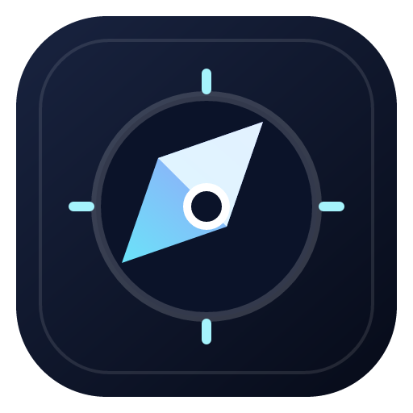
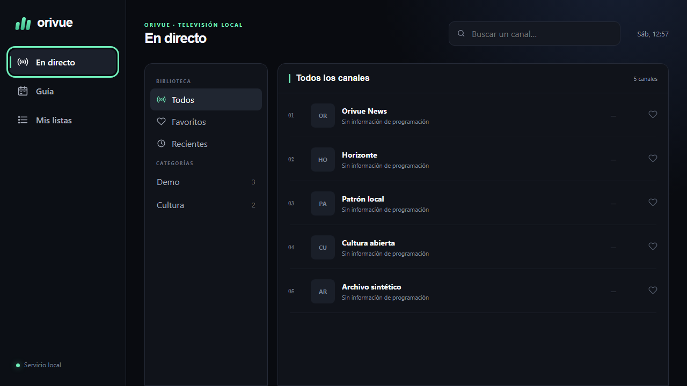

# Orivue

<p align="center">
  
</p>

Orivue es un reproductor y organizador IPTV local-first, libre y pensado para
televisión, móvil y ordenador. Importa fuentes M3U/M3U8, cuentas Xtream Codes
o archivos locales que el usuario tiene derecho a usar, organiza canales con
guía XMLTV y reproduce MPEG-TS y HLS desde una interfaz React manejable con
mando, teclado, ratón o pantalla táctil. No proporciona canales, listas,
suscripciones ni contenido.



> **Nombre provisional:** “Orivue” puede cambiar antes de 1.0. No existe
> afiliación con TiviMate, Ace Stream ni sus fabricantes.

## Plataformas

Un único proyecto Tauri 2 genera todas las aplicaciones. El detalle de formatos,
instalación y estado de validación está en [docs/platforms.md](docs/platforms.md).

| Plataforma    | Artefacto                   | Reproductor                             | Estado                                    |
| ------------- | --------------------------- | --------------------------------------- | ----------------------------------------- |
| Linux         | `.deb`, `.rpm`, `.AppImage` | Web (mpegts.js, hls.js)                 | Compila y pasa tests; probado en Linux    |
| Windows       | `.exe`, `.msi`              | Web (WebView2)                          | Compila en CI; sin prueba manual          |
| macOS         | `.dmg`                      | Web (WebKit: HLS nativo, mpegts.js)     | Compila en CI; sin prueba manual          |
| Android 7+    | `.apk`                      | Nativo Media3/ExoPlayer, web de reserva | Compila en CI; no validado en dispositivo |
| Fire TV Stick | mismo `.apk` (sideload)     | Nativo Media3/ExoPlayer, web de reserva | Compila en CI; no validado en dispositivo |
| iOS 17.1+     | `.app` de simulador         | Web (HLS nativo, mpegts.js)             | Compila en CI macOS; no validado          |

“Compila en CI” significa que el workflow produce el artefacto. No se afirma
que funcione en un dispositivo hasta que exista una prueba manual anotada en
[CHANGELOG.md](CHANGELOG.md).

## Qué hace

- **Fuentes:** URL M3U/M3U8/m3u_plus (`tvg-id`, `tvg-name`, `tvg-logo`,
  `group-title`, `#EXTVLCOPT`, cabeceras `|User-Agent=`), cuentas Xtream Codes
  (host, usuario y contraseña, o una URL `get.php` pegada tal cual) y archivos
  locales. Las URL `url-tvg` de la cabecera se usan como guía automáticamente.
- **Biblioteca:** categorías, búsqueda, favoritos, recientes, canales y grupos
  ocultos, nombres personalizados, asignación manual de guía, "continuar
  viendo", zapping por número y último canal, refresco automático.
- **A la carta:** películas y series de cuentas Xtream Codes con temporadas,
  episodios y barra de progreso.
- **Guía:** XMLTV con ahora/siguiente y línea temporal; asociación por
  `tvg-id`, por nombre o manual.
- **Reproducción:** MPEG-TS directo (`output=ts`), HLS, MP4/MKV progresivo y
  `acestream://` a través de un motor local opcional. En Android y Fire TV el
  reproductor nativo decodifica MP2, AC-3 y MPEG-2; en el resto de plataformas
  la webview decodifica H.264/AAC.
- **Privacidad:** todo se guarda en el dispositivo. Las credenciales se
  redactan en pantalla, errores y registros. No hay telemetría.
- **Idiomas:** español e inglés, con detección automática.

## Principios

- **Local-first y privado:** sin servidor, sin cuenta, sin sincronización.
- **Seguro por defecto:** el proxy de streams escucha solo en `127.0.0.1`, exige
  un token por ejecución, solo sirve URLs de la sesión abierta y bloquea
  destinos de red privada salvo que el usuario lo permita.
- **Portátil:** el dominio es TypeScript sin dependencias de Node y corre en
  cualquier webview; las operaciones de red privilegiadas están en Rust.
- **Legal:** Orivue solo debe usarse con fuentes y emisiones que el usuario
  tenga derecho a reproducir.

## Arquitectura

```text
apps/web (React + Vite)
   │ llama en proceso a
   ▼
packages/engine  ── importación M3U/Xtream/XMLTV, IndexedDB, favoritos, EPG
   │ plataforma (fetch acotado, almacén clave-valor, sesiones de reproducción)
   ▼
apps/desktop/src-tauri (Rust)
   ├── crates/stream-proxy ─ proxy loopback con token y lista de orígenes
   └── crates/tauri-plugin-orivue-native ─ Media3 (Android/Fire TV), iOS
```

Decisiones en [docs/architecture.md](docs/architecture.md),
[docs/adr](docs/adr) (la vigente es ADR-0006) y la API del engine en
[docs/api.md](docs/api.md).

## Requisitos

- Node.js 22 o posterior (`.nvmrc`), Corepack y pnpm 11.
- Rust estable y los [prerrequisitos de Tauri 2](https://v2.tauri.app/start/prerequisites/)
  para escritorio.
- Android Studio o SDK + NDK y Java 17 para Android/Fire TV.
- macOS con Xcode y `xcodegen` para iOS.

```bash
corepack enable
pnpm install --frozen-lockfile
```

## Desarrollo

```bash
pnpm dev          # web en http://localhost:5173 con relay de desarrollo
pnpm verify       # formato, lint, tipos, tests y build
pnpm test:e2e     # Playwright contra la build de la web
```

En el navegador el motor funciona igual que en las apps; el servidor de Vite
incluye un relay `/__orivue/*` para esquivar CORS solo en desarrollo.

Escritorio, Android e iOS:

```bash
pnpm --filter @orivue/desktop desktop:dev
pnpm --filter @orivue/desktop desktop:build
pnpm --filter @orivue/desktop android:dev      # requiere ANDROID_HOME y NDK_HOME
pnpm --filter @orivue/desktop android:build    # APK universal
pnpm --filter @orivue/desktop ios:init && node apps/desktop/scripts/patch-ios-project.mjs
pnpm --filter @orivue/desktop ios:dev          # solo macOS
```

Pruebas Rust del proxy:

```bash
cargo test --manifest-path apps/desktop/src-tauri/Cargo.toml -p orivue-stream-proxy
```

No pegues en capturas, terminales compartidos o issues URLs de listas: suelen
incluir usuario, contraseña o token. Para probar con tus propias credenciales,
guárdalas en `.env.local` (ignorado por git) y nunca en fixtures ni tests.

## Primera prueba con datos ficticios

1. `pnpm dev` y abre la dirección que muestra Vite.
2. En **Mis listas → Añadir lista → Archivo local** importa `fixtures/sample.m3u`,
   o sirve `fixtures/` con `node scripts/serve-fixtures.mjs` y usa su URL.
3. Reproduce un canal de demostración y comprueba los estados del reproductor.
4. `fixtures/sample.xml` sirve como guía XMLTV.

## Xtream Codes

Pega la URL `http://panel/get.php?username=…&password=…&type=m3u_plus&output=ts`
en el formulario de URL o rellena host, usuario y contraseña en la pestaña
Xtream. Orivue valida la cuenta en `player_api.php`, obtiene los canales en
directo de la API (`get_live_categories` y `get_live_streams`), el catálogo a
la carta de `get_vod_streams`/`get_series`, carga la guía de `xmltv.php` y
muestra estado, caducidad y conexiones. Elige `MPEG-TS` (recomendado) o `HLS`
como formato de stream.

La lista `get.php` solo se descarga si el panel bloquea la API: incluye todas
las películas y episodios y en proveedores grandes supera los 100 MB. El
límite para esa descarga es de 120 MB (`maxPlaylistBytes`) y el de la guía
XMLTV de 120 MB (`maxEpgBytes`); si la guía lo supera, los canales se importan
igualmente y Mis listas muestra el aviso.

## Ace Stream opcional

Orivue funciona sin Ace Stream. Si hay un motor en `127.0.0.1:6878`, los
canales `acestream://<id>` se resuelven a `/ace/getstream?id=` a través del
proxy loopback. No se incluye, descarga ni redistribuye el motor y no se ha
validado con una instalación real.

## Privacidad y seguridad

- Sin servicio HTTP local: la UI llama al motor en proceso y a comandos Tauri.
- El proxy de streams no acepta destinos arbitrarios: solo URLs de la sesión
  (canal, redirecciones y segmentos de su manifiesto), con token por ejecución.
- Destinos loopback y de red privada se bloquean salvo Ace Stream o la opción
  “permitir red local” de Ajustes.
- Listas y guías se descargan con límites de tamaño y tiempo desde Rust
  (conexión 20 s, 120 s sin datos, 5 min por lista o guía).
- Las peticiones se presentan como VLC (`VLC/3.0.21 LibVLC/3.0.21`) porque
  muchos paneles descartan en silencio clientes que no reconocen; el agente se
  puede cambiar en Ajustes → Red y una lista puede fijarlo con `|User-Agent=`.
- Las credenciales Xtream se guardan en el almacén local de la app sin cifrado
  adicional; protege tu cuenta de usuario y no compartas el directorio de datos.
- Android permite tráfico HTTP en claro porque las fuentes IPTV suelen serlo.

Lee [docs/security-model.md](docs/security-model.md) y [SECURITY.md](SECURITY.md).

## Solución de problemas

**La lista no se importa.** Comprueba que la URL sea accesible desde el
dispositivo, devuelva M3U y no haya caducado. En el navegador sin Tauri, CORS
puede impedir la descarga: usa `pnpm dev` o la app de escritorio.

**El canal no reproduce en escritorio o iOS.** El reproductor web solo decodifica
H.264/AAC; con MP2, AC-3 o MPEG-2 verás un aviso de códec. Usa Android/Fire TV
o pide HLS al proveedor. Un token caducado o un origen caído muestran el error
HTTP del proveedor.

**No aparece EPG.** Verifica `tvg-id`, el horizonte de guía (Ajustes) y la fecha
de la última actualización de la guía en Mis listas.

**El mando no mueve el foco.** Activa el modo televisión en Ajustes; en Fire TV
se detecta automáticamente.

## Rendimiento

Con 30 000 canales y una guía de 1 000 canales × 7 días (`ORIVUE_PERF=1 pnpm
--filter @orivue/engine exec vitest run test/engine.perf.test.ts`): listar,
buscar y agrupar tardan unos 50 ms, ahora/siguiente de 500 canales 214 ms en
frío y 0 ms en caliente, la línea temporal de 200 canales 424 ms y el arranque
desde almacenamiento 140 ms. La importación completa ronda 17 s bajo la
IndexedDB simulada de los tests; en un navegador real es más rápida.

## Firma del APK de Android

Sin keystore, CI publica una APK de depuración que se instala pero no se
actualiza sobre otra firmada distinta. Para firmar de forma estable:

```bash
keytool -genkeypair -v -keystore orivue-release.jks -alias orivue \
  -keyalg RSA -keysize 4096 -validity 10000
base64 -w0 orivue-release.jks > orivue-release.jks.b64
```

Guarda en el repositorio (Settings → Secrets and variables → Actions) los
secretos `ANDROID_KEYSTORE_BASE64` (contenido de `.b64`),
`ANDROID_KEYSTORE_PASSWORD`, `ANDROID_KEY_ALIAS` (`orivue`) y
`ANDROID_KEY_PASSWORD`. El siguiente workflow producirá `orivue-universal-release.apk`
firmada. Conserva el `.jks`: sin él no podrás publicar actualizaciones.

## Limitaciones conocidas

- Ningún instalador está firmado ni notarizado.
- Android, Fire TV e iOS solo se han compilado en CI; falta validación física.
- iOS no incluye un reproductor nativo: TS con códecs fuera de H.264/AAC no se
  reproduce.
- Ace Stream no se ha probado con un motor real.
- Los proveedores controlan códecs y disponibilidad; Orivue no puede garantizar
  que un stream autorizado sea reproducible.

## Contribuir

Empieza por [CONTRIBUTING.md](CONTRIBUTING.md) y
[docs/good-first-issues.md](docs/good-first-issues.md). No se exige CLA: al
contribuir aceptas publicar tu aportación bajo la licencia MIT del proyecto.
